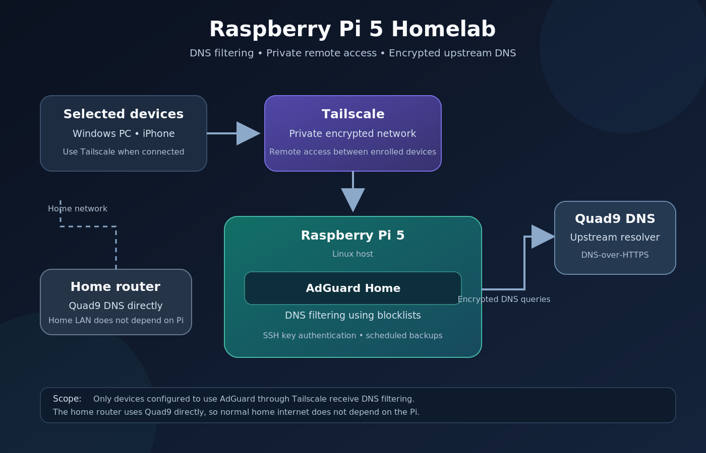

# Raspberry Pi 5 — Network Privacy & DNS Filtering

A personal homelab project built with Raspberry Pi 5, AdGuard Home, Tailscale, and Quad9 DNS.

## About the Project

This project explores how a small, self-hosted Linux server can provide DNS-based ad and tracker blocking, secure remote access, and encrypted upstream DNS resolution.

The system is designed to let selected devices use the Raspberry Pi's DNS filtering service through Tailscale, without making the entire home network dependent on the Pi.

## Technologies Used

* **Raspberry Pi 5** — Hardware platform
* **Linux** — Server operating system
* **AdGuard Home** — DNS-based ad and tracker blocking
* **Tailscale** — Private network and remote access
* **Quad9** — Upstream DNS provider
* **DNS-over-HTTPS (DoH)** — Encrypted upstream DNS queries
* **OpenSSH** — Secure remote administration
* **systemd** — Automated backup scheduling

## System Architecture

The home router uses Quad9 DNS directly. This keeps ordinary home internet access independent of the Raspberry Pi.

Devices connected through Tailscale can use the Raspberry Pi as their DNS server when configured to do so.

## Key Features

### DNS Filtering

AdGuard Home blocks domains included in configured filtering lists.

The current configuration includes:

* AdGuard DNS filter
* HaGeZi Multi PRO++

The goal is to reduce advertising, tracking, and access to known unwanted domains.

### Remote Access

Tailscale provides private connectivity between enrolled devices and the Raspberry Pi.

### Encrypted DNS

AdGuard Home forwards DNS requests to Quad9 using DNS-over-HTTPS.

This encrypts DNS queries between the Raspberry Pi and the upstream DNS resolver.

### SSH Hardening

SSH is configured to use public-key authentication. Password-based SSH login and direct root login are disabled.

### Privacy-Conscious Logging

AdGuard Home is configured to hide client IP addresses in its logs and retain query history for a limited period.

### Automated Backups

A systemd timer runs a scheduled backup service to preserve important configuration and application data.

## Testing and Validation

The following checks have been performed:

| Test                                           | Result              |
| ---------------------------------------------- | ------------------- |
| Resolve `example.com` through AdGuard Home     | Passed              |
| Resolve `doubleclick.net` through AdGuard Home | Blocked             |
| Connect to the Raspberry Pi through Tailscale  | Passed              |
| Resolve normal domains from Windows            | Passed              |
| Block an advertising domain from Windows       | Passed              |
| Run the automated backup service               | Tested successfully |

These tests confirm basic DNS resolution, domain blocking, remote connectivity, and backup operation. They do not guarantee that every advertisement or malicious domain will be blocked.

## Design Decisions

* The home router uses Quad9 DNS so ordinary internet access does not depend on the Raspberry Pi.
* Selected Tailscale-connected devices can use AdGuard Home for DNS filtering.
* SSH access is restricted to public-key authentication.
* Query logging is limited to reduce the amount of retained DNS history.

## Limitations

* DNS filtering cannot block every advertisement.
* Some applications may use their own DNS mechanisms.
* Aggressive blocklists may occasionally block legitimate domains.
* Devices using the Raspberry Pi as their DNS server may experience DNS failures if the Pi becomes unavailable.
* DNS filtering and encrypted DNS do not provide complete anonymity.

## Future Improvements

* Document the complete installation process.
* Test backup restoration.
* Improve recovery procedures for DNS outages.
* Add a network architecture diagram.

## Disclaimer

This repository documents a personal homelab and learning project. It is not intended to guarantee complete anonymity or comprehensive protection against every online threat.

Sensitive information, credentials, private keys, and environment-specific configuration files are intentionally excluded.
